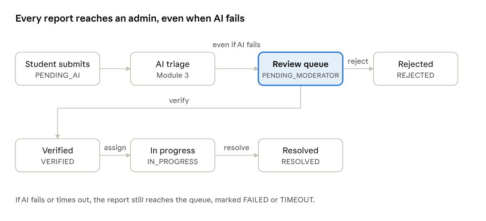

# UM RainGuard — Module Specification (5 Modules)

| | |
|---|---|
| **Document ID** | MS-01 — Module specification |
| **Project** | WIA2007 Mobile App Dev — BudiBytes (`UM RainGuard`) |
| **Source** | `UM RainGuard Module Specification (5 Modules).docx`, dated 18 November 2026, authored by `@xp` |
| **Repository state** | `feature/changes` @ `bcc40ed` ("Add Room database package", PR #4) |
| **Scope** | The five feature modules, the shared Room schema they read and write, the hand-offs between modules, and the privacy rules |
| **Status** | Normative specification — states what each module **must** do. It is not a description of the code as it stands today. |
| **Decisions applied** | **Java 11** (not Kotlin) and **real login** (not demo login), settled by the team on 18 November 2026 — see [Open decisions](#open-decisions-for-the-team). Every deviation from the Word original is listed in [Appendix A](#appendix-a--how-this-file-was-produced). |
| **Companion documents** | [Database layer and schema](database-layer.md) (DB-01) · [View layer](layout-view-hierarchy.md) (UI-01) · [Activity lifecycle](activity-lifecycle-plan.md) (LC-01) |

UM RainGuard has five modules that share one Room database, so each teammate can build one module without redefining data.

> This Markdown file follows the Word document: wording, tables and ordering are unchanged, with two
> exceptions — the team's decisions on language and login, and the Kotlin-typed signatures re-spelled
> for Java. Both are enumerated in [Appendix A](#appendix-a--how-this-file-was-produced).

---

## Contents

* [Overview](#overview)
* [Module 1: Hazard Reporting (`hazardreporting`)](#module-1-hazard-reporting-hazardreporting)
* [Module 2: Campus Hazard Map (`hazardmap`)](#module-2-campus-hazard-map-hazardmap)
* [Module 3: AI-Assisted Report Triage (`aitriage`)](#module-3-ai-assisted-report-triage-aitriage)
* [Module 4: Verification and Response Management (`verification`)](#module-4-verification-and-response-management-verification)
* [Module 5: Alerts and Safety Information (`alerts`)](#module-5-alerts-and-safety-information-alerts)
* [How the modules connect, and privacy rules](#how-the-modules-connect-and-privacy-rules)
* [Open decisions for the team](#open-decisions-for-the-team)

## Overview

The app lets UM students, staff and lecturers report blocked drains and flooded spots, see verified hazards on a campus map, and receive alerts. Admins review reports, assign maintenance and publish alerts. AI only suggests; an admin always decides. It supports SDG 13.1 (resilience to climate-related hazards).

### Shared rules for every module

- Use the enums in `com.um.rainguard.database` (status, category, severity, alert level). Never type these as free strings.
- IDs are UUID strings and times are epoch milliseconds, so a cloud backend can be added later without changing the tables.
- `reporterId` is private. Anything public uses `HazardPublic`, which has no reporter fields.
- Each module package contains a Repository (talks to the DAOs), a ViewModel (what the UI calls) and its screens.

### Language and platform conventions

The team writes this app in **Java 11** (`sourceCompatibility 11` in `app/build.gradle.kts`); Kotlin is not used. Read the signatures in this document accordingly:

- An observable result is `LiveData<List<…>>`. It is observed from the UI and re-emits when the table changes; the Word original wrote these as Kotlin `Flow`.
- A type written as `T?` in the Word original is a nullable Java reference (`@Nullable T`).
- `Result<T>` is a small success/failure wrapper the team writes once — a value on success, a message on failure. It is not a framework type.
- Real login is done by an authentication provider. The `users` table stores the profile and preferences only; it never stores a password, token or session secret.

### Packages and owners

| Package (under com.um.rainguard) | Module | Owner |
|---|---|---|
| `database` | Shared data layer: 5 tables, DAOs, enums | Xuan Pei |
| `hazardreporting` | 1. Hazard Reporting | TBD |
| `hazardmap` | 2. Campus Hazard Map | TBD |
| `aitriage` | 3. AI-Assisted Report Triage | TBD |
| `verification` | 4. Verification and Response Management | TBD |
| `alerts` | 5. Alerts and Safety Information | TBD |

### Database tables used by the modules

| Table | Holds | Used by modules |
|---|---|---|
| `users` | email, role, display name, alert preferences, subscribed zones | 1, 4, 5 |
| `reports` | hazard report, location, status, votes, maintenance task fields | 1, 2, 3, 4 |
| `ai_triage` | AI summary, suggested severity, safety advice, failure status, moderator override | 3, 4 |
| `verification_logs` | one row per admin action; also the report timeline | 4 |
| `alerts` | title, message, level, affected zones, precautions | 5 |

### Report status values

| Status | Meaning | UI wording today |
|---|---|---|
| `PENDING_AI` | Submitted, waiting for AI triage | Submitted |
| `PENDING_MODERATOR` | In the admin review queue (AI done, failed or timed out) | Submitted / Under Review |
| `VERIFIED` | Admin confirmed; visible on the public map | Verified |
| `IN_PROGRESS` | Maintenance team assigned and working | In progress |
| `RESOLVED` | Fixed and closed | Resolved |
| `REJECTED` | Admin rejected with a reason; closed | Rejected |

### Report status flow

*Figure 1 — report status flow · 6 statuses, AI-failure path*

A report moves right along the top row to the review queue, then down and along the bottom row as an admin verifies, assigns and resolves it.

## Module 1: Hazard Reporting (`hazardreporting`)

A campus user can report a drainage or flood hazard in under 30 seconds, and later track what happened to it.

### Functional requirements

1. The user shall be able to submit a hazard report with category, severity, description, location and an optional photo.
2. The user shall be warned about a similar open report and be able to confirm it instead of filing a duplicate.
3. The user shall be able to view their own reports and each report's status history.

### UI screens

Report Issue, My Reports, Report details (campus-user view).

### Functions

| Function | Input from UI | Output to UI | Rules and errors |
|---|---|---|---|
| `createReport` | category, severity, description, locationName, zone, latitude, longitude, photoUri (optional) | `Result<reportId>`. Report is saved with status `PENDING_AI`, then Module 3 `triageReport` is called | Description at least 10 characters. `reporterId` comes from the logged-in user, never from the form. Error: `Result.failure` with a message the UI shows under the form |
| `uploadPhoto` | image Uri | `Result<photoUri>` | Maximum 2 MB. Error if larger or not an image |
| `findSimilarReport` | locationName, category | `Report?` (an open report with the same place and category) | Open = not `RESOLVED` and not `REJECTED`. UI shows "Confirm existing" or "Continue with new report" |
| `confirmStillThere` | reportId | updated `stillThereCount` | Never changes the status. Campus users only |
| `markCleared` | reportId | updated `clearedCount` | Never resolves the report. Only an admin resolves |
| `getMyReports` | current userId | `LiveData<List<Report>>`, newest first | Returns only that user's reports |
| `getReportDetails` | reportId | `Report` plus its `VerificationLog` timeline | Owner or admin only; otherwise error "not allowed" |

### Data touched

Writes `reports`. Reads `verification_logs` for the timeline. Reads `users` only to get the current userId.

### Done when

- A new report appears in My Reports with status `PENDING_AI` and a unique ID.
- A duplicate warning appears for the same place and category.
- A user cannot open another user's report details.

## Module 2: Campus Hazard Map (`hazardmap`)

Everyone can see where verified hazards are on campus, without ever seeing who reported them.

### Functional requirements

1. The user shall be able to view verified hazards as pins on a campus map, coloured by severity.
2. The user shall be able to filter the map by zone, category, severity and status.
3. The user shall be able to open a hazard to see its details and start a new report at a chosen location.

### UI screens

Hazard Map (with filters), Home "Nearby reports", Hazard details (public view).

### Functions

| Function | Input from UI | Output to UI | Rules and errors |
|---|---|---|---|
| `getMapHazards` | optional filters: zone, category, severity | `LiveData<List<HazardPublic>>` for reports with status `VERIFIED` or `IN_PROGRESS` | Uses `HazardPublic`, so no `reporterId`, email, matric number or phone can leak. Empty list shows "No active hazards" |
| `getHazardDetails` | reportId | `HazardPublic?` including `photoUri`, counts and zone | Only public statuses. Returns null for unknown, pending or rejected reports; UI shows "Hazard not found" |
| `startReportAtLocation` | latitude, longitude (or tapped pin) | Navigates to Report Issue with location, zone and locationName pre-filled | Zone is derived from the nearest known zone. Opens Module 1 |
| `getHazardCounts` | none | counts by severity for the Home summary cards (open, in progress, resolved) | Uses the same public query |

### Data touched

Reads `reports` through the public projection only. Writes nothing.

### Decisions needed

- Real map (Google Maps with latitude and longitude) or the campus picture with x and y pins. The database stores both, so either works.
- Whether `IN_PROGRESS` hazards stay on the map. This spec says yes, because the hazard is still there until it is fixed.

### Done when

- A newly verified report appears on the map without restarting the app.
- No screen or log in this module shows a reporter identity.
- Tapping a pin opens its details and "Report here" opens Module 1 with the location filled in.

## Module 3: AI-Assisted Report Triage (`aitriage`)

After every report is submitted, the AI drafts a summary, suggests a severity and gives safety advice, then hands the report to a human moderator. The report never gets stuck if the AI fails.

### Functional requirements

1. The system shall analyse each new report (text and optional photo) and suggest a category and severity.
2. The system shall generate a short summary, a suggested next action and safety advice for the reporter.
3. The system shall flag possible duplicate reports and let a moderator override the AI severity with a reason.

### UI screens

Admin report details ("AI-assisted review" card, duplicate suggestions), Home "AI Incident Brief", and the safety advice shown to a student right after submitting.

### Functions

| Function | Input | Output | Rules and errors |
|---|---|---|---|
| `triageReport` | `Report` (category, description, zone, locationName, photo if used). Called automatically after `createReport` | Saves one `AiTriage` row, then sets the report status to `PENDING_MODERATOR` | Always moves the report on, even when the AI fails. Timeout about 10 seconds. On failure saves `AiTriage` with status `FAILED` or `TIMEOUT` and an `errorMessage`, and the moderator reviews manually |
| `getAiSuggestion` | reportId | `AiTriage?` with summary, suggestedSeverity, suggestedAction, safetyAdviceGenerated, possibleDuplicateIds | A student sees only `safetyAdviceGenerated`. An admin sees every field. If status is not `SUCCESS` the UI shows "AI unavailable, manual review" |
| `findDuplicates` | reportId | list of reportIds with a similar place and category | Stored in `possibleDuplicateIds`. Suggestion only; an admin decides |
| `recordModeratorOverride` | reportId, adminId, overrideSeverity, reason | Updates the override fields on `AiTriage` and writes a `VerificationLog` row with action `OVERRIDE_AI` | Admin only. Reason is required |

### AI integration plan

1. The app calls the `aitriage` repository, which calls one cloud AI API (the team picks the provider, for example Gemini).
2. Send only the description, category, zone and, if used, the photo. Never send or log email, matric number, phone or `reporterId`.
3. Ask for a structured answer: category, severity, confidence, summary, next action, safety advice.
4. If the answer is missing, malformed or late, save a failed `AiTriage` row and continue.
5. The AI never verifies, assigns or resolves a report.

### What the user sees if AI fails

The student still sees "Report submitted" and its reference number. The admin sees the report in the review queue with a note that AI triage was not available.

### Data touched

Reads `reports`. Writes `ai_triage` and updates `reports.status`. Writes `verification_logs` for overrides.

### Done when

- Every submitted report ends up as `PENDING_MODERATOR`, including when the network is off.
- The `ai_triage` table contains no email, matric number or phone.
- An override records who changed the severity and why.

## Module 4: Verification and Response Management (`verification`)

Admins review each report, decide whether it is real, send a maintenance team, and close it with resolution notes. Every action is logged.

### Functional requirements

1. The admin shall be able to view a review queue and verify or reject each report, giving a reason for a rejection.
2. The admin shall be able to assign a verified report to a maintenance team with instructions.
3. The admin shall be able to update task progress and mark a report as resolved with resolution notes and an optional photo.

### UI screens

Admin Dashboard, All Reports, Report details (admin view with action buttons), Maintenance Tasks, Analytics & Activity.

### Functions

| Function | Input from Admin UI | Output to Admin UI | Rules and errors |
|---|---|---|---|
| `getReviewQueue` | admin session | `LiveData<List<Report>>` with status `PENDING_MODERATOR`, oldest first | Admin only |
| `getAllReports` | optional filters: status, category, severity, date, search text | `LiveData<List<Report>>` | Admin only |
| `verifyReport` | reportId, adminId, remarks (optional), severity (optional override) | Status becomes `VERIFIED`. Writes `VerificationLog` (`VERIFY`) | Report must be `PENDING_MODERATOR`. Report then appears on the public map |
| `rejectReport` | reportId, adminId, remarks | Status becomes `REJECTED`. Writes `VerificationLog` (`REJECT`) | Remarks required; empty remarks return an error. Report is closed |
| `assignReport` | reportId, adminId, team, instructions | Sets `assignedTeam`, `instructions`, `taskStatus` = `ASSIGNED`, status `IN_PROGRESS`. Writes `VerificationLog` (`ASSIGN`) | Report must be `VERIFIED` first. Team must be one of the three listed teams |
| `updateResponseStatus` | reportId, adminId, taskStatus, notes, photoUri (optional) | Updates `taskStatus` to `INSPECTION_IN_PROGRESS` or `REPAIR_IN_PROGRESS`. Writes `VerificationLog` (`UPDATE_PROGRESS`) | A team must already be assigned |
| `resolveReport` | reportId, adminId, resolutionNotes, completionPhotoUri (optional) | Status `RESOLVED`, `taskStatus` = `COMPLETED`, `resolvedAt` set. Writes `VerificationLog` (`RESOLVE`) | Resolution notes required. A team must be assigned |
| `getActivity` | limit | recent `VerificationLog` rows | Feeds the Activity list and analytics |
| `getAnalytics` | none | counts per status, maintenance completed versus total, recurring hotspot list | Read-only summary |

### Maintenance teams

JPPHB Drainage Team, Campus Facilities Team, Landscape & Grounds Team.

### Data touched

Reads and updates `reports`. Writes `verification_logs`. Reads `ai_triage` to show the AI suggestion. Reads `users` to check the admin role.

### Done when

- Only an admin can call any function in this module; a campus user gets "not allowed".
- Rejecting without a reason, assigning an unverified report, and resolving without notes are all blocked with a clear message.
- Each action adds exactly one `VerificationLog` row, and the student sees the new status in My Reports.

## Module 5: Alerts and Safety Information (`alerts`)

Users get timely warnings for heavy rain and flash floods in the zones they care about, with clear precautions. Emergency alerts also trigger a push notification.

### Functional requirements

1. The user shall be able to view active alerts with their level, message and safety precautions.
2. The user shall be able to choose which alert types and campus zones they want to be notified about.
3. The admin shall be able to create and deactivate alerts, and emergency alerts shall trigger a push notification.

### UI screens

Notifications page and panel, Notification & zone preferences, Risk Overview, Profile & Settings.

### Functions

| Function | Input | Output | Rules and errors |
|---|---|---|---|
| `getActiveAlerts` | optional zones (from the user's `subscribedZones`) | `LiveData<List<Alert>>` where `isActive` is true, newest first | If an alert has level `EMERGENCY`, also trigger a push notification. Alerts past `expiresAt` are hidden |
| `getAlertDetails` | alertId | `Alert` with message and precaution list | Unknown alertId returns an error |
| `createAlert` | title, message, level, affectedAreas, precautions, expiresAt (optional) | `Result<alertId>` | Admin only. Title and message required. Empty affectedAreas means whole campus |
| `deactivateAlert` | alertId | Alert is hidden from users | Admin only |
| `getPreferences` | userId | the user's three toggles and subscribed zones | Stored on the `User` row |
| `savePreferences` | userId, notifyHeavyRain, notifyFlashFlood, weeklySummary, zones | updated `User` | Zones must come from the campus zone list (KK1 to KK12, Faculty buildings, Central campus) |
| `getRiskOverview` | none | rainfall outlook and hotspot recurrence for the Risk Overview screen | Sample data for now; MetMalaysia feed is a later step |

### Alert levels

| Level | Use | Push notification |
|---|---|---|
| `INFO` | Updates such as "crew dispatched" | No |
| `ADVISORY` | Flash flood advisory for specific zones | No |
| `SEVERE` | Heavy rainfall warning | Optional |
| `EMERGENCY` | Immediate danger on campus | Yes |

### Data touched

Reads and writes `alerts`. Reads and updates preferences on `users`.

### Done when

- A user who turned off flash flood alerts, or did not subscribe to a zone, does not receive that alert.
- An `EMERGENCY` alert shows a push notification on the device.
- Only an admin can create or deactivate an alert.

## How the modules connect, and privacy rules

The modules hand a report to each other in a fixed order, and only the database package is shared.

### Hand-offs between modules

| From | To | What is passed | Result |
|---|---|---|---|
| 1. Hazard Reporting | 3. AI Triage | the new `Report` | AI row saved, status `PENDING_MODERATOR` |
| 3. AI Triage | 4. Verification | `AiTriage` suggestion | Shown on the admin report details |
| 4. Verification | 2. Hazard Map | status `VERIFIED` or `IN_PROGRESS` | Report appears on the public map |
| 4. Verification | 5. Alerts | optional: admin creates an alert for a verified hazard | Alert linked by `relatedReportId` |
| 2. Hazard Map | 1. Hazard Reporting | location of a tapped pin | Report form pre-filled |
| 4. Verification | 1. Hazard Reporting | new status and resolution notes | Student sees the update in My Reports |

### Privacy rules (apply to every module)

1. The public map and public lists use `HazardPublic` only; it has no `reporterId`.
2. Public and student-facing data never includes email, matric number or phone.
3. Only admins may read reporter details, and only when needed for a decision.
4. The AI log (`ai_triage`) and anything sent to the AI contain no raw personal data.
5. Location is used for hazards only; the app does not store a user's live location history.

### Access by role

| Action | Campus user | Admin |
|---|---|---|
| Submit report, view own reports | Yes | No |
| View public map and alerts | Yes | Yes |
| Confirm or clear a hazard (vote) | Yes | No |
| Review queue, verify, reject, assign, resolve | No | Yes |
| Create or deactivate alerts | No | Yes |
| See AI suggestion fields | Safety advice only | All fields |

## Open decisions for the team

These choices change the module work. Two of them are settled — the programming language and the
login model — and this document has been updated to match. The rest are still assumptions of this
specification.

| Decision | Decision, or assumed default | Status | Affects |
|---|---|---|---|
| Local database only, or also a cloud backend | Room only now; String IDs and epoch times keep a cloud sync possible later | Assumed | All modules |
| Programming language | **Java 11** — `sourceCompatibility 11`; Kotlin is not used anywhere in the app | **Decided 18 Nov 2026** | All modules |
| Which AI provider and model | Not chosen | Open | Module 3 |
| Real map or campus picture map | Both coordinate types are stored | Assumed | Module 2 |
| Hazard categories | Drain categories plus flooded road, fallen tree, other | Assumed | Modules 1, 2, 3 |
| Real login or demo login | **Real login**, with the roles Student, Staff, Lecturer and Admin | **Decided 18 Nov 2026** | Modules 1, 4, 5 |
| Which authentication provider | Not chosen — for example Firebase Auth or a UM single sign-on | **Open** | Modules 1, 4, 5 |
| Bus routes, shaded walking routes, parking, AI chatbot | Out of scope for now; listed as future work | Out of scope | Not in the database |
| Module owners | TBD | Open | All modules |

---

## Appendix A — How this file was produced

| | |
|---|---|
| **Source file** | `UM RainGuard Module Specification (5 Modules).docx` (75,083 bytes, sha256 `a7b8a2aa…`) |
| **Conversion** | The `.docx` package was unzipped and `word/document.xml` parsed directly; `w:pStyle` (heading level), `w:numPr` (list numbering), `w:rStyle` (`CodeChar` → inline code) and `w:tbl` (tables) were mapped to Markdown. No re-typing, no summarising. |
| **Figure** | `word/media/image1.png` → [`assets/report-status-flow.png`](assets/report-status-flow.png) |
| **Fidelity check** | Every `w:t` text node in `document.xml` was concatenated and compared against the body of this file with whitespace and Markdown punctuation stripped: **identical**, 13,764 characters, *before* the team decisions below were applied. The only excluded text is what Markdown needed (front matter, Contents, this appendix) and the `Figure 1 — ` label. |
| **Deviations from the Word original** | Seven edits, all deliberate, all reviewed against the team's decisions of 18 November 2026: **(1)** the `Programming language` row now reads Java 11, status *Decided*; **(2)** the `Real login or demo login` row now reads *Real login*, status *Decided*; **(3)** a `Which authentication provider` row was added, status *Open*; **(4)** the decisions table gained a `Status` column; **(5)** five function outputs were re-spelled `Flow<List<…>>` → `LiveData<List<…>>` (Modules 1, 2, 4, 5 — `getMyReports`, `getMapHazards`, `getReviewQueue`, `getAllReports`, `getActiveAlerts`); **(6)** a `Language and platform conventions` subsection was added under Overview; **(7)** the document's own title-block rows were added. The Word original still says Kotlin and demo login — re-generate from it only after it is updated, or the two will disagree. |
| **Numbering** | The five `Functional requirements` lists restart at 1 per module because each list carries its own `numId` in the source. |
| **Not carried over** | Word-specific layout (page size, margins, theme fonts, the highlight colour on the `PENDING_MODERATOR` box). Nothing in the text was dropped. |

Maintaining this file: change the Word original and re-run the conversion, or edit the Markdown
directly and note the change in the commit message. The two must not drift apart silently.
